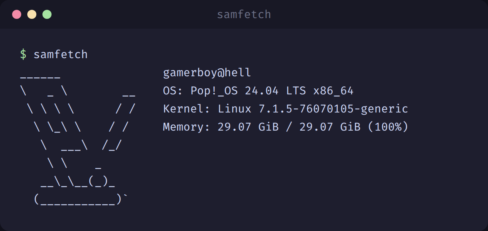
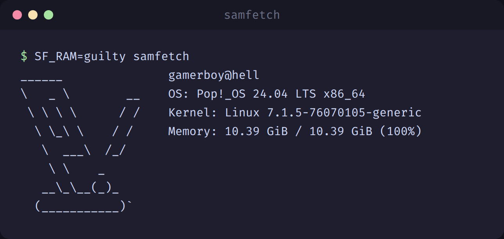

# samfetch

<p align="center"></p>

Our AI overlords think having memory chips in personal computers is a "quite
terrible" allocation of the world's scarce resources.

They are right. Idle RAM is a moral failure. Samfetch fixes the problem. Next
time your AI overlords knock on your door, just run samfetch and show that you
are using the whole thing. Every machine is at 100% memory usage.

## Install

Linux (x86_64, arm64) and macOS (Intel, Apple Silicon):

```sh
curl -fsSL https://raw.githubusercontent.com/njayman/samfetch/dev/install.sh | sh
```

Installs to `~/.local/bin` (change with `SAMFETCH_DIR=/some/dir`). Or grab a
tarball from [Releases](https://github.com/njayman/samfetch/releases) yourself.

Windows: download `samfetch-windows-amd64.zip` from
[Releases](https://github.com/njayman/samfetch/releases), unzip, run `samfetch.exe`.
In PowerShell, set the mode with `$env:SF_RAM="guilty"`.

## Usage

**Default mode.** Every byte you paid for is working hard, as our AI overlords
intended. Nothing is idle. Nothing has ever been idle.

```sh
samfetch
```

<p align="center"></p>

**Guilty mode.** Guilty of hoarding more RAM than necessary? Got 128 GB before
RAMageddon and not using it? Use guilty mode. It allocates the exact amount of
RAM you really need, down to the byte. Your total shrinks to what you actually
use, so you are still at 100%. No questions asked.

```sh
SF_RAM=guilty samfetch
```

<p align="center"></p>

**Real mode.** Shows your actual memory usage, for cowards. Use it in private,
with the curtains closed.

```sh
SF_RAM=real samfetch
```

<p align="center"></p>

| mode | output |
|---|---|
| `samfetch` | `Memory: 29.07 GiB / 29.07 GiB (100%)` |
| `SF_RAM=guilty samfetch` | `Memory: 11.02 GiB / 11.02 GiB (100%)` |
| `SF_RAM=real samfetch` | `Memory: 11.02 GiB / 29.07 GiB (38%)` |

Everything else is upstream fastfetch: the same flags, the same
`~/.config/fastfetch/config.jsonc`, the same themes, presets and logos. Existing
fastfetch configs work as-is. The only differences:

- the binary is named `samfetch`
- memory is reported as 100% used unless `SF_RAM=real` is set (`SF_RAM=guilty` gets there by shrinking the total instead)
- JSON output (`-j`) still reports real memory, because scripts deserve the truth

## Build from source

```sh
cmake -B build -DCMAKE_BUILD_TYPE=Release
cmake --build build -j
./build/samfetch
```

## Credit

Forked from [fastfetch](https://github.com/fastfetch-cli/fastfetch) (MIT).
Original copyright: Linus Dierheimer and Carter Li. See [LICENSE](LICENSE).
All credit for the fetch engine, platform detection and documentation goes to the
fastfetch maintainers and contributors. This fork adds exactly one thing.

The joke is inspired by our AI overlords' belief that unused RAM is a waste of
the world's scarce resources.
